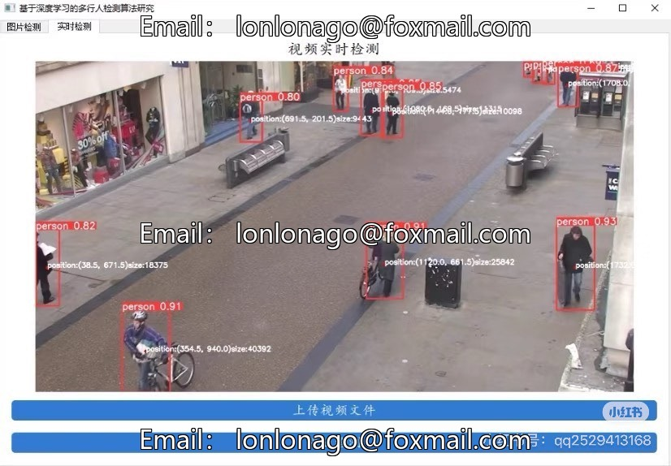

# Multi-person detection algorithm based on the deep learning YOLOv5 model, supported by images and

## Body

Multi-person detection algorithm based on the deep learning YOLOv5 model, supports real-time detection of images and videos. The code and text content are for reference only.

The content includes basic knowledge of multi-person detection algorithms, introduction to the YOLOv5 model, target detection process, data preparation, and environment setup, suitable for learning and research in computer vision and target detection.

Virtual materials, once sold, are non-refundable.
Interested friends, click "I want" to proceed.

## Images

## Payment

Here is a pay link on Stripe ( https://buy.stripe.com/3cs8yP7sY87d0vu9AB ). Please contact me lonlonago@foxmail.com after funding $89, and I will send you a complete data files , thank you!

